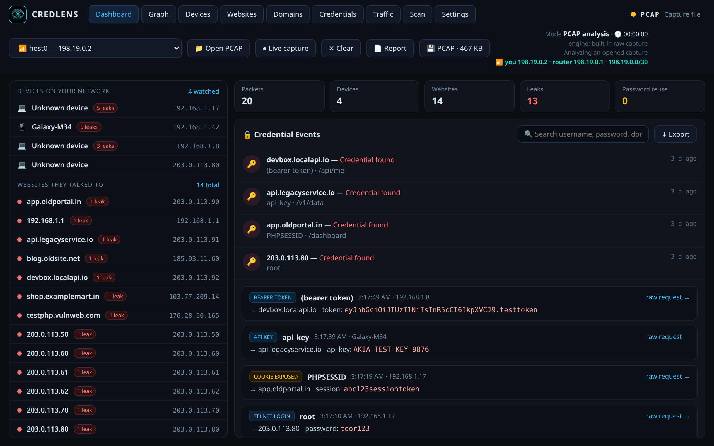
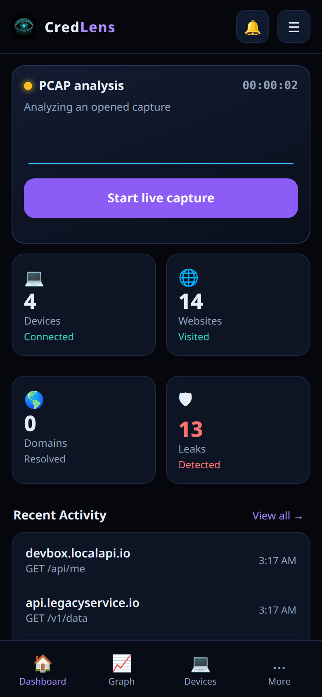
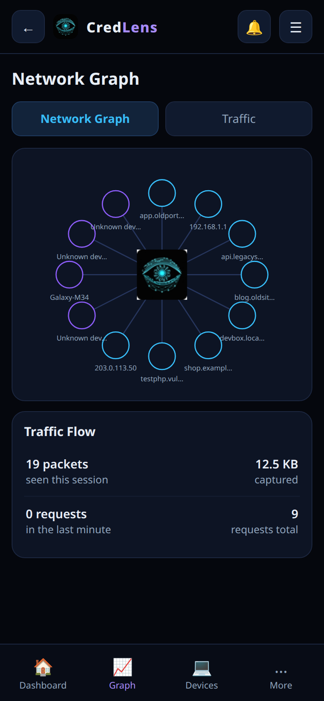
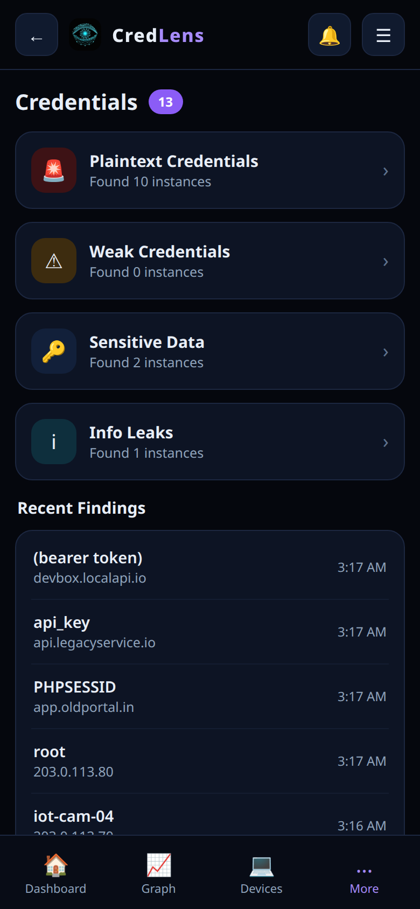

# CredLens — See the traffic. Detect the exposure.


**CredLens** is a passive network credential-leak detector for Windows, Linux, and Android.
It watches traffic on your own network and surfaces leaked credentials in plain words —
logins, passwords, session cookies, API keys, bearer tokens, and NTLM hashes —
with the device that leaked them, the website they went to, and the exact request.

> **Passive by design.** CredLens never sends traffic on your behalf. It only reads
> what already flows past the machine it runs on. It cannot see inside HTTPS
> content — that invisibility is the point: whatever still leaks in plain text
> is exactly what it shows you.

## Watch the demo

<video src="docs/demo.mp4" controls width="360"></video>

A 42-second walkthrough of the Android app: dashboard, devices, credential
categories, graph, websites, domains, live traffic, scan, settings, and
starting live capture. ([Download the demo](docs/demo.mp4))

## Screenshots

**Desktop dashboard (Windows / Linux)**



**Android app (new mobile UI)**





## What it catches

- HTTP form logins, GET-parameter credentials, Basic Auth, JSON and multipart logins
- FTP, POP3, IMAP, SMTP-AUTH, Telnet, and MQTT logins
- Session cookies at issuance (Set-Cookie) and deduped re-sends
- API keys in URLs and headers, Bearer tokens
- NTLM hashes (NetNTLMv2 → hashcat mode 5600, v1 → 5500)
- Password reuse across sites, with alerts
- Full session reports and downloadable PCAPs of what was captured

## Device identity engine

Most tools show you an IP address. CredLens names the device, using five
layers, strongest first — and every name in the UI is marked with its source:

1. **Announced name** — DHCP option 12, mDNS, LLMNR, NetBIOS, rDNS
2. **Browser model** — parsed from the device's own HTTP User-Agent
3. **DHCP OS fingerprint** — option-55 parameter-request lists, scored per OS
4. **Maker service domains** — e.g. Transsion, Samsung, Huawei, Xiaomi traffic
5. **Your label** — set it once per device, it follows the MAC address

A phone that announces its name nowhere (empty DHCP hostname, no mDNS/LLMNR
replies) cannot be named by any passive tool — CredLens says so instead of
guessing, and falls back to its traffic fingerprint.

## Platforms

| | Windows | Linux | Android |
|---|---|---|---|
| Live capture | ✅ | ✅ | ✅ via VPN (IPv4 + IPv6) |
| Hotspot watch | ✅ frame capture | — | ✅ rooted phones only |
| Dashboard, scan, reports | ✅ | ✅ | ✅ |
| Toast pop-ups | ✅ | — | — |
| tshark engine | ✅ | — | — |

Android hotspot watch needs root: on an unrooted phone, client traffic
bypasses apps at kernel level, so no app can watch it. Everything else —
VPN capture, dashboard, scan, reports — runs on a normal unrooted phone.

See [docs/PLATFORMS.md](docs/PLATFORMS.md) for the honest limits.

## Quick start

**Windows / Linux** (Python 3.11+, standard library only — no dependencies):

```bash
python credlens.py          # Windows
sudo python3 credlens.py    # Linux (raw capture needs root)
```

Then open http://127.0.0.1:8890 — the dashboard is served on loopback only.

**Android:** install the APK from the
[Releases page](https://github.com/DEVIL1433/credlens/releases),
allow the one-time VPN prompt, and press **Start live capture**.
On a rooted phone, turn the phone's hotspot on and use **Hotspot watch**
to see connected devices' traffic under their own addresses.

## Visibility rule

On normal Wi-Fi, a laptop sees only its **own** traffic plus broadcasts.
Visibility comes from **position**, never software: run it on the device
itself, on a hotspot you turn on, or on a router you own. CredLens does
not do ARP-spoofing, MITM poisoning, or WPA2-PSK decryption — on any
network, yours included.

## Tests

```bash
python3 sim_tests.py   # 99/99 — capture, extraction, identity, API guards
```

## Security

- No redaction anywhere: real secrets surface in full, on your own machine
  only. The dashboard binds loopback and rejects forged Host headers and
  cross-site POSTs.
- See [SECURITY.md](SECURITY.md) for reporting issues.
- See [docs/ARCHITECTURE.md](docs/ARCHITECTURE.md) for engines and data flow.

## Releases

Every version is published with its APK on the
[Releases page](https://github.com/DEVIL1433/credlens/releases) —
v1.2, v1.3, v1.4, v1.5, v1.6. See [CHANGELOG.md](CHANGELOG.md).

## License

Source-available — see [LICENSE](LICENSE). Built by Devil.
